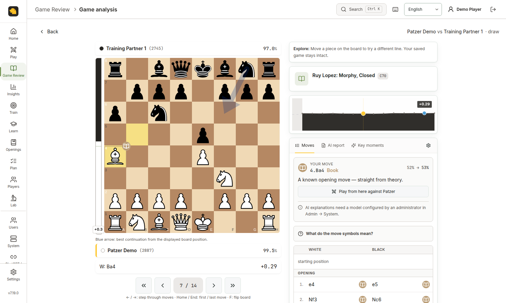
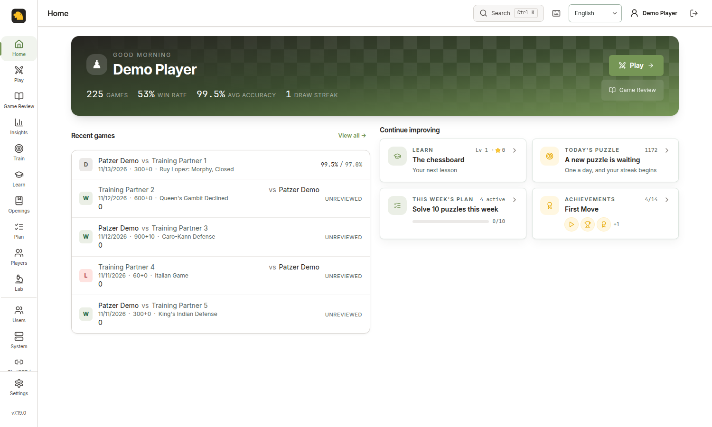
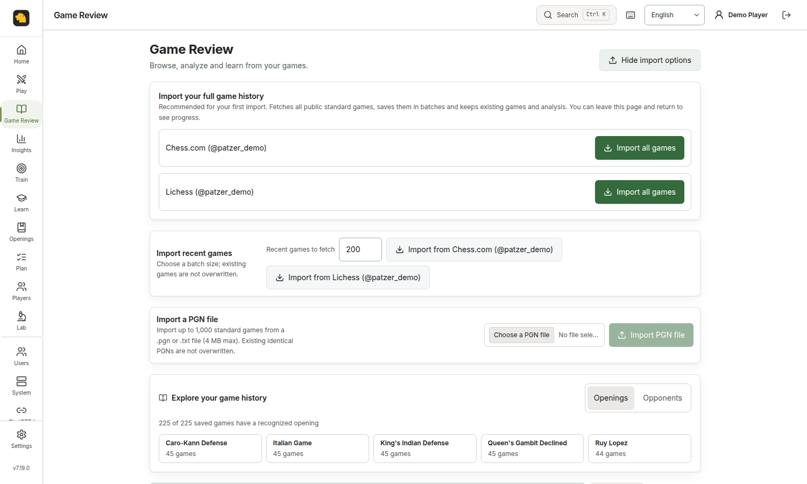
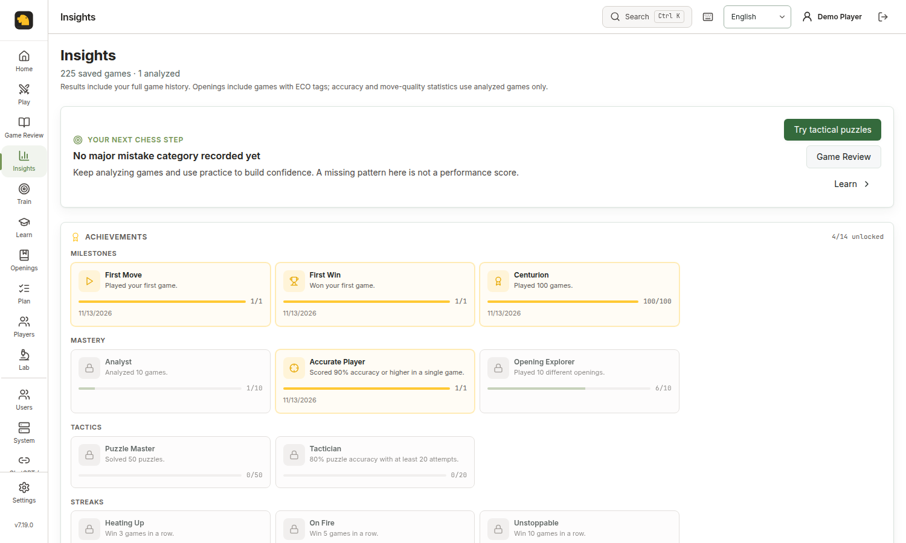
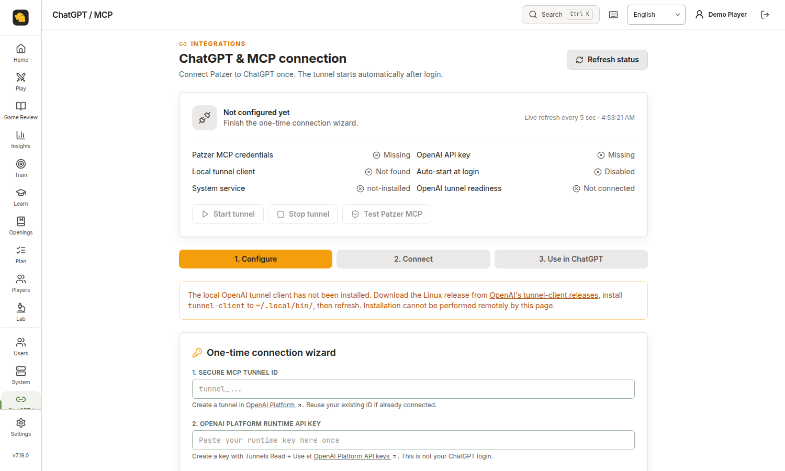
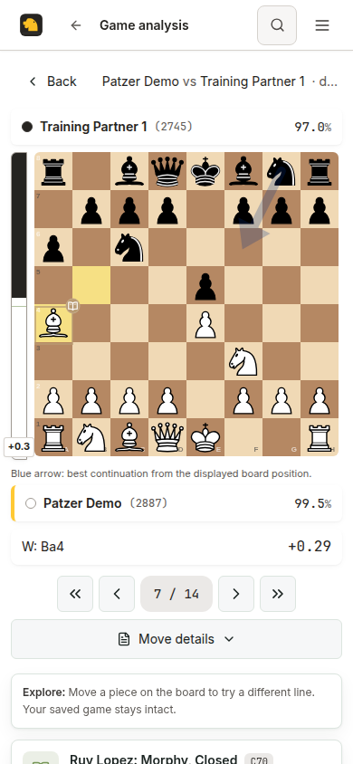
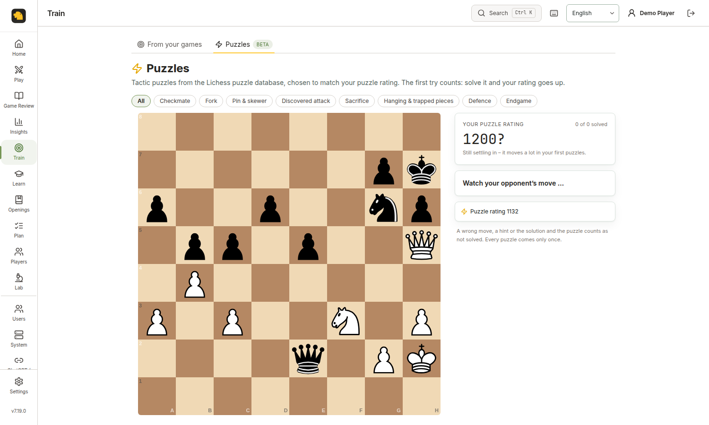
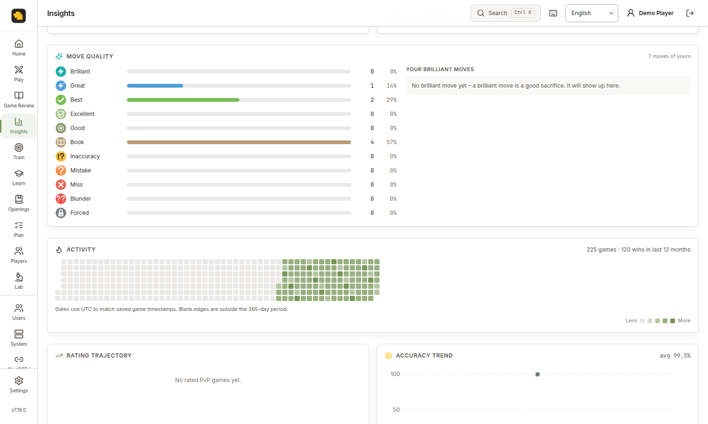

<p align="center">
  
</p>

<h1 align="center">Patzer</h1>

<p align="center">
  <b>Your private chess workspace.</b><br/>
  Self-hosted Game Review, complete game imports, play, coaching, training, insights and an optional ChatGPT/MCP connection.
</p>

<p align="center">
  <a href="https://codespaces.new/MousaXD/patzer?quickstart=1">
    
  </a>
</p>

<p align="center">
  <a href="https://github.com/MousaXD/patzer/actions/workflows/ci.yml"></a>
  <a href="LICENSE"></a>
  <a href="https://github.com/MousaXD/patzer/stargazers"></a>
  <a href="https://github.com/MousaXD/patzer/tree/main"></a>
  <a href="https://github.com/SikamikanikoBG/patzer"></a>
</p>

<p align="center">
  
  <br/>
  <sub><b>Game Review in the current fork</b> — a live Stockfish evaluation, move classifications and board-first analysis. Screenshot uses a disposable demo account.</sub>
</p>

<p align="center">
  <a href="#whats-new-in-this-fork">What's new</a> ·
  <a href="#screenshots">Screenshots</a> ·
  <a href="#get-started-with-this-fork">Get started</a> ·
  <a href="#chatgpt-and-mcp-integration">ChatGPT / MCP</a> ·
  <a href="#configuration">Configuration</a>
</p>

> **This is [MousaXD/patzer](https://github.com/MousaXD/patzer), an independently developed fork of [SikamikanikoBG/patzer](https://github.com/SikamikanikoBG/patzer).** Thanks to the original maintainer and contributors. This README documents the **fork's `main` branch**. Its additional features are **not** automatically present in upstream Docker images or Codespaces.

## Why Patzer

- **Own the data and the server.** SQLite lives on your machine. Run the app from source or a locally built Docker image, with no mandatory cloud account or subscription. External chess-provider imports, hosted engine/LLM options and MCP tunnels are optional connections.
- **Chess-first coaching.** Stockfish and `chess.js` produce the move evidence; your optional Ollama/vLLM (or DeepSeek) model explains it. The fork adds stronger source-integrity and evidence checks so outdated or contradictory review text is rejected.
- **One place to improve.** Import your full history, find openings and recurring mistakes, review engine alternatives, practise positions, follow a weekly improvement plan and track progress.
- **Made for households and clubs.** Separate profiles, ratings, live friend games, kid-friendly options, access controls and five interface languages.

## What's new in this fork

This section compares the current fork with the original project's [`main` at `31b6e55`](https://github.com/SikamikanikoBG/patzer/tree/31b6e55), rather than claiming that every core Patzer feature was invented here.

| Area | Added or substantially improved in `MousaXD/patzer` |
| --- | --- |
| **Full game history** | **Import all games** for linked Chess.com and Lichess accounts. Chess.com walks public monthly archives; Lichess streams its full public export. Bounded saves, duplicate detection, progress reporting and safe retry after an interruption. The regular 20 / 100 / 200 recent-game sync remains available. |
| **Game Library** | Server-side search across large histories; stable pagination past 200 games; discovery by opening or opponent; source, result, time-control, date, analyzed and bookmark filters; PGN file upload with validation; clearer import errors and keyboard/touch behavior. |
| **Game Review workspace** | Larger, responsive chessboard; polished move timeline, engine lines, alternative variations and interactive graph navigation; position/FEN and PGN tools; personal notes, bookmarks and practice-from-mistakes; improved mobile controls, focus restoration and accessible dialogs. |
| **Trustworthy analysis and coaching** | Versioned analysis provenance, stale-cache protection when game PGN or starting position changes, safeguards against out-of-date AI reports, stricter engine-evidence checks and independent release/benchmark tests. |
| **Play and live multiplayer** | Reconnection, restored live/bot games, multi-tab control handoff, clearer challenge handling, safer confirm-before-resign/discard behavior, defensive WebSocket validation and first-move/board-coordinate fixes. |
| **Insights and learning** | Lifetime statistics that do not silently stop at the most recent 200 analyzed games; clearer accuracy coverage, opening/opponent exploration and links between Review, personal tactics, lessons and improvement plans. |
| **New application shell** | Compact left navigation rail, roomier game views, responsive home/dashboard hierarchy, desktop and mobile refinements, keyboard accessibility, translated import feedback and better text-zoom support. |
| **ChatGPT / MCP** | Account-scoped MCP bridge with **eight tools**, local stdio and loopback HTTP transports, plus a Linux localhost **Admin → ChatGPT / MCP** setup and connection-status wizard for OpenAI Secure MCP Tunnel. |
| **Local updates and verification** | Admin-managed checking/installation of CI-verified commits on supported local Linux/systemd setups, more source-integrity/regression tests, real-browser PvP/resume testing and CI checks for Node 20/22 and Docker. |

**Two different limits:** the **200-game** choice is for a *quick recent import*, and the Library only renders a page of games at a time for performance. Neither limits the number of games the new full-history job can save. See [First-time game history import](#first-time-game-history-import).

## Core features (including those inherited from upstream)

The fork retains the original Patzer experience, in addition to the changes above:

- **Game Review** — pull your public Chess.com or Lichess games (or paste a PGN; Chess.com games can sync on their own), analyze with bundled Stockfish, get chess.com-style classifications (Brilliant / Great / Best / Excellent / Good / Book / Inaccuracy / Mistake / Miss / Blunder), accuracy %, estimated Elo, eval graph, key moments, top engine lines, a "What's the threat?" probe, and master-game statistics for the position.
- **Play vs Bot** — full games against Stockfish at seven named tiers (Kid → Stockfish max), all standard time controls, a queue of up to six premoves shown on the board, kid-mode blunder warnings.
- **Play vs Friend** — real-time PvP between profiles on the same server over WebSocket, with draw offers, takebacks and one-click rematch. Playing across the internet is a tunnel away — see the [FAQ](docs/FAQ.md#can-i-play-a-friend-who-lives-somewhere-else).
- **Players & profiles** — a directory of everyone on your server with a rating leaderboard, live presence and public profiles (record, per-time-class ratings, your head-to-head), challenge-from-profile, and a "missed invitations" rail.
- **AI Coach (your LLM)** — point at any [Ollama](https://ollama.com) or [vLLM](https://docs.vllm.ai) host (or, if you have no GPU to spare, the hosted DeepSeek API). A coach, not a commentator: it explains *why* a move works or fails (what it allows, hangs or wins, and the opponent's best answer), shows the better move and other good ones with what they achieve, connects the mistake to your own recent games ("4 of your last 10 games: leaving a piece unprotected", your weakest phase, positions you missed in the opening trainer) and links a matching Learn lesson. Hints point you at what matters without giving the move away. It never contradicts the engine: an answer that praises a mistake is caught before you see it. Audience-tuned for Kid / Beginner / Intermediate / Advanced.
- **Family-ready** — multi-user with admin console, open / invite-only / closed sign-up, per-profile language, kid-mode blunder warnings, "horsey" piece names for the youngest profiles.
- **Single sign-on (optional)** — sign in with Authentik, Keycloak or any other OpenID Connect provider: SSO next to passwords or SSO only, admins chosen by a provider group, automatic accounts, and a logout that ends the provider session too. See [docs/OIDC.md](docs/OIDC.md).
- **Learn (beta)** — 69 interactive lessons in four levels, from how the pieces move to tactics, mating patterns and endgames. Stars and progress per profile; kid mode tells the same lessons in simpler words.
- **Opening trainer (beta)** — drill 16 built-in main lines or any line from your own repertoire; the moves you miss come back in a daily review queue.
- **Multilingual** — English, Bulgarian, Spanish, German and Russian out of the box, UI *and* coach prompts. Adding a language is one table entry per file — see CONTRIBUTING.
- **Self-hosted, single container** — runs on a Pi, NAS or old laptop. The local database remains under your control; optional providers and integrations use external network connections only when enabled.
- **Phone-friendly** — full-width board, sticky action bar and a swipe-up move list on small screens.
- **Update awareness** — the original release notice remains available. The fork additionally has a guarded, manual **check / install verified update** flow on supported local Linux/systemd installations. Neither mechanism silently upgrades a Docker deployment; see the [local update guide](docs/LOCAL_GITHUB_UPDATES.md).

## Screenshots

<table>
<tr>
<td width="50%" valign="top">

<br/><sub><b>Home</b> — simplified dashboard with your recent games, next lesson, tactics, weekly plan and achievements.</sub>
</td>
<td width="50%" valign="top">

<br/><sub><b>Game Library</b> — full-history import from both services, safe batch imports, PGN upload and opening discovery.</sub>
</td>
</tr>
<tr>
<td width="50%" valign="top">

<br/><sub><b>Insights</b> — account-scoped achievements, results and improvement recommendations (additional analytics appear farther down the page).</sub>
</td>
<td width="50%" valign="top">

<br/><sub><b>ChatGPT / MCP</b> — the localhost-only admin wizard, tunnel status and private connection setup.</sub>
</td>
</tr>
<tr>
<td width="50%" valign="top">

<br/><sub><b>Board-first review</b> — real Stockfish analysis, move-by-move exploration and alternative moves.</sub>
</td>
<td width="50%" valign="top" align="center">

<br/><sub><b>Mobile review</b> — readable touch controls and a board that stays usable on a phone.</sub>
</td>
</tr>
<tr>
<td width="50%" valign="top">

<br/><sub><b>Puzzle training</b> — tactical positions with categories and a separate puzzle rating.</sub>
</td>
<td width="50%" valign="top">

<br/><sub><b>Deeper Insights</b> — move-quality breakdown, activity heatmap and accuracy trends.</sub>
</td>
</tr>
</table>

<sub>Fresh screenshots from this fork, captured against a **throwaway local database** with fictional players and games. The featured Game Review uses real local Stockfish analysis. No real accounts, API credentials or tunnel IDs appear. Recreate them with [`scripts/capture-readme-screenshots.mjs`](scripts/capture-readme-screenshots.mjs) after building the app and installing Playwright. Dark mode (auto / light / dark) is still supported per profile.</sub>

## Get started with this fork

**Use this repository's source** to get the new full-history import, MCP bridge, upgraded Review and UI. Do not run the upstream `SikamikanikoBG/patzer` Docker image and expect fork-only features to appear. A fresh installation serves Patzer at <http://localhost:8800> and presents a one-time setup wizard (unless you enable SSO-only mode).

**Option A — try the fork in GitHub Codespaces**

[](https://codespaces.new/MousaXD/patzer?quickstart=1)

The included `.devcontainer` installs Node dependencies and Stockfish. Open the forwarded port named **Patzer (Vite dev — open this)**. Hosted Codespaces can run the app, but the **localhost Linux/systemd MCP wizard** is intended for an installed machine, not Codespaces or Docker.

**Option B — run from source (Linux / macOS / Windows)**

```bash
git clone https://github.com/MousaXD/patzer.git
cd patzer
npm ci
npm run setup   # Install a supported Stockfish binary in ./bin/
npm run dev
```

Requirements: **Node.js 20.11+** for the app (Node 22+ for the optional standalone MCP bridge). Visit <http://localhost:5173> for the development UI; the API listens on <http://localhost:8800>. If you already use port 8800, see [Configuration](#configuration).

**Option C — build your own fork Docker image**

```bash
git clone https://github.com/MousaXD/patzer.git
cd patzer
docker build -t patzer-fork:local .
docker run -d --name patzer-fork --restart unless-stopped \
  -p 8800:8800 -v patzer-fork-data:/app/data \
  patzer-fork:local
```

Alternatively, use the included Compose override so you **build this fork** rather than pulling the original maintainer's image:

```bash
docker compose -f docker-compose.yml -f docker-compose.fork.yml up -d --build
```

The override disables upstream-image auto-pulling. Its **persistent volume** belongs to your fork deployment; never point two live Patzer processes at the same SQLite file. `docker-compose.yml` alone continues to reference the original image for backward compatibility.

> **What works without any extras:** play vs Stockfish, play vs friend on the same server,
> move classification, accuracy %, eval graph, opening detection. The setup wizard takes you
> straight to a working board.
>
> **What needs an LLM:** the AI Coach commentary voice. Until you point Patzer at an Ollama or
> vLLM host, the *Coach* panel just shows the engine facts in plain text.
>
> **What needs a Chess.com or Lichess username:** importing your public games for review. Without it
> you can still load PGNs by paste or play live and review from the move list.

### First-time game history import

Link your Chess.com or Lichess username in **Settings**, then open **Library → Import more games**
(the import options are already expanded on an empty library). Choose **Import all games** next to
your linked account. This imports your entire **public, completed standard-chess history**, not
just the 200 newest games. Chess.com is fetched month by month; Lichess streams its full export.
Progress appears in Library, and you can leave the page while the server continues importing.
Standard games with malformed or unavailable PGN data are skipped instead of being misclassified.

Imports are saved in bounded, deduplicated transactions. If a provider becomes unavailable or
the server is restarted, your already-imported games remain safe; run **Import all games** again
to finish missing games without overwriting saved reviews or notes. After that, use the separate
**Import recent games** 20/100/200-game selector for quicker routine syncs. Imported games are
not analyzed with Stockfish automatically in bulk. The Library paginates search results so the
number of games visible at once does not limit the number imported.

You'll want, optionally:

- **For the AI Coach:** an [Ollama](https://ollama.com) or [vLLM](https://docs.vllm.ai) server reachable from the Patzer container (pick the provider in *Admin → System*). The wizard validates the URL and lists available models for you. Patzer accepts loopback / RFC1918 / `*.local` / `host.docker.internal` Ollama hosts only — public-Internet model proxies aren't supported here. The one hosted exception is DeepSeek, which you opt into with an API key in *Admin → System*.
- **For Game Review on your own games:** a Chess.com and/or Lichess username (entered later in *Settings*).

To use a different host port, run with `-p 9000:8800` (or set `HOST_PORT=9000` if you're using `docker compose`).

If you're terminating TLS at a reverse proxy, set `COOKIE_SECURE=true` in the container's environment so session cookies aren't shipped over plaintext HTTP.

To sign in through Authentik, Keycloak or another OpenID Connect provider instead of (or next to) Patzer passwords, see [Single sign-on](docs/OIDC.md). With `OIDC_ONLY=true` a fresh install skips the setup wizard below: the first SSO login creates the admin.

## ChatGPT and MCP integration

The fork provides an optional **Model Context Protocol (MCP)** bridge for asking an MCP-capable assistant to inspect and review games saved in **your own authenticated Patzer account**. It is **not enabled by default**, and installing Patzer does **not** automatically connect your ChatGPT account. The bridge ships in [`integrations/mcp/`](integrations/mcp/README.md); for the transport, see OpenAI's [Secure MCP Tunnel documentation](https://developers.openai.com/api/docs/guides/secure-mcp-tunnels).

| MCP tool | What it does |
| --- | --- |
| `list_games` | Lists recent saved games (one page, maximum 100). Read-only. |
| `get_game` | Reads a saved game, its PGN and any current stored analysis. |
| `analyze_position` | Gets local Stockfish lines for a FEN position without editing a game. |
| `analyze_game` | Runs/caches Stockfish analysis for a saved game; may use substantial CPU. |
| `get_game_review` | Reads an existing cached AI game report. |
| `generate_game_review` | Generates and stores AI coaching prose; requires a configured LLM and analyzed game. |
| `import_chesscom_games` | Imports up to 200 recent public Chess.com games per call. Writes to your library. |
| `import_lichess_games` | Imports up to 200 recent public Lichess games per call. Writes to your library. |

**Full historical imports** use **Library → Import all games**, not those two 200-game MCP tools. All MCP operations are scoped to the configured Patzer user; tools that analyze or import can consume CPU or write cached records.

### Option 1 — ChatGPT with a private OpenAI Secure MCP Tunnel

On a **localhost-only Linux/systemd source installation**, start Patzer with `HOST=127.0.0.1`, log in as an administrator and open **Admin → ChatGPT / MCP**. The wizard guides you through:

1. Installing the [official OpenAI `tunnel-client`](https://github.com/openai/tunnel-client/releases/latest) on the same machine.
2. Creating a tunnel in [OpenAI Platform → Tunnels](https://platform.openai.com/settings/organization/tunnels) and a runtime API key with **Tunnels Read + Use** permissions.
3. Entering your tunnel ID, runtime key and local Patzer password **into the local admin wizard**, then selecting **Save & connect**.
4. Checking **Tunnel connected** and **Test Patzer MCP** before adding/selecting that tunnel in ChatGPT's custom MCP plugin configuration.

The wizard can manage a persistent systemd user service, start/stop it and report local login and control-plane readiness. It **cannot** verify that ChatGPT itself has installed or selected the plugin; test by asking ChatGPT to list your Patzer games. Custom MCP plugin creation and tunnel access depend on your OpenAI workspace permissions. **This wizard does not run inside Docker, Codespaces or on a public Patzer server.** See the [full connection wizard guide](docs/MCP_CONNECTION_WIZARD.md).

### Option 2 — local stdio MCP client (no tunnel needed)

Use **Node.js 22+** for this standalone bridge. First start Patzer locally on port 8800 and run this in an **interactive terminal** to configure the bridge's private credentials:

```bash
bash integrations/mcp/scripts/configure-local.sh
```

That script prompts for your Patzer login, stores the password in a mode-600 local file, creates the ignored `integrations/mcp/.env` and tests access. The equivalent `.env` layout is in [`integrations/mcp/.env.example`](integrations/mcp/.env.example):

```dotenv
PATZER_URL=http://127.0.0.1:8800
PATZER_USERNAME=your_patzer_username
PATZER_PASSWORD_FILE=/absolute/private/path/to/patzer-password-file
```

Point any compatible **local stdio MCP client** at the bridge (the config-file location and syntax vary by client):

```json
{
  "mcpServers": {
    "patzer": {
      "command": "node",
      "args": ["/absolute/path/to/patzer/integrations/mcp/stdio.mjs"]
    }
  }
}
```

Ensure `node` in the MCP client's environment resolves to **Node 22+**, and substitute the actual absolute project path. The bridge reads its private `.env` itself; **never put your password or a Platform API key in this JSON**. Verify protocol discovery with:

```bash
node --test integrations/mcp/test.mjs
```

### Option 3 — local HTTP MCP for clients supporting Bearer headers

The alternate transport listens **only on `127.0.0.1:8811/mcp`** and requires an independent 32+ character key. After configuring the same Patzer credentials as above:

```bash
export MCP_API_KEY="$(openssl rand -hex 32)"
node integrations/mcp/server.mjs
```

An MCP client that supports custom headers can connect to `http://127.0.0.1:8811/mcp` with `Authorization: Bearer <your MCP_API_KEY>`. This **is not a direct ChatGPT web setup**: arbitrary Bearer headers are not a replacement for a supported ChatGPT MCP authentication/tunnel flow. **Never expose this local bridge, its key, or the Patzer credential file to the public internet.** See the [audited setup guide](integrations/mcp/README.md) for details and limitations.

### Important boundaries

- The full-history importer fetches **public, completed, valid standard-chess games**; private, unavailable, variant and malformed games may not be importable. It does not automatically run Stockfish on every historical game.
- The Game Library is paginated; a 200-game visible/recent-batch limit does **not** delete or hide older saved history from server-side search.
- Local Stockfish analysis needs CPU. Optional LLM providers, Chess.com/Lichess imports, the hosted engine mode and an OpenAI MCP tunnel make external network connections where enabled.
- If a large import stops or a server restarts, saved batches survive and the operation can be retried; in-flight progress indicators themselves are not durable job queues.

## How it's built

<p align="center">
  <picture>
    <source media="(prefers-color-scheme: dark)" srcset="docs/diagrams/architecture-dark.svg">
    
  </picture>
</p>

The coach teaches from facts it is handed rather than inventing chess analysis: the server computes tactical evidence with `chess.js` ([`server/src/coach/tactics.ts`](server/src/coach/tactics.ts)), engine variations with Stockfish, and recurring mistakes from game history ([`server/src/coach/memory.ts`](server/src/coach/memory.ts)). An optional LLM turns that evidence into coaching ([`server/src/coach/coaching.ts`](server/src/coach/coaching.ts)), with additional claim checks in this fork. The diagram above describes the **core app**; the optional MCP bridge is a **separate local process**, not a public endpoint inside the Docker container.

## Local development

Requirements: **Node.js 20.11+** for Patzer; **Node.js 22+** only if using the optional MCP bridge. Follow [Get started with this fork](#get-started-with-this-fork) for Docker and Codespaces.

```bash
git clone https://github.com/MousaXD/patzer.git
cd patzer
npm ci
npm run setup   # downloads Stockfish 17 into ./bin/ (Windows, Linux, macOS)
npm run dev
```

- Server: <http://localhost:8800>
- Vite dev server (HMR): <http://localhost:5173> — proxies `/api` and `/ws` to the server.

`npm run setup` dispatches to `setup.ps1` (Windows) or `setup.sh` (Linux/macOS) and picks the official
build for your CPU; on an older x86 CPU without AVX2 run `STOCKFISH_ASSET=stockfish-ubuntu-x86-64-sse41-popcnt npm run setup`.
A package-manager Stockfish (`apt install stockfish` / `brew install stockfish`) works too — the server
also looks in `/usr/bin`, `/usr/local/bin`, `/opt/homebrew/bin` and `/usr/games`.

Useful scripts:

```bash
npm run typecheck   # tsc -b across server + web + tests (no emit)
npm test            # vitest — chess logic, cache consistency, import, UI and integration tests
npm run test:e2e    # boots a real server on a scratch DB and plays a PvP game over two sockets
npm run test:ui     # two-browser PvP check (Playwright/Chromium required)
npm run test:resume-ui  # browser resume, takeback, resignation and review checks
node --test integrations/mcp/test.mjs  # MCP protocol and transport checks (Node 22+)
npm run build       # production build of both workspaces
```

The GitHub [CI workflow](https://github.com/MousaXD/patzer/actions/workflows/ci.yml) runs Node 20/22 checks, Docker builds and browser/engine regression checks. All screenshot fixtures are generated with a **disposable SQLite database**; none of the README screenshot captures should point at your real profile.

## Deploying to a home server

Build from **your own clone** and use the [fork Compose override](docker-compose.fork.yml) described above. The base `docker-compose.yml` and upstream Watchtower label are retained for compatibility, but **on their own they point to the original maintainer's Docker image**, which will not include the features documented here. The override replaces the image/build source and disables upstream-image Watchtower updates.

For a home server, copy this repository to the target and run:

```bash
docker compose -f docker-compose.yml -f docker-compose.fork.yml up -d --build
docker compose -f docker-compose.yml -f docker-compose.fork.yml ps
```

The inherited `deploy.ps1` (Windows) and `deploy.sh` (Linux/macOS) remain available as SSH deployment helpers, but **verify the remote Compose configuration uses this fork override** before relying on them. Do not attach a second running container to the same SQLite database. Fork Docker Hub publishing is optional and needs your own registry credentials; see [publishing for forks](docs/DOCKER_HUB_PUBLISHING_FOR_FORKS.md).

For those optional legacy SSH scripts, create `.env.deploy` (gitignored) on the workstation you're deploying *from*:

```
HOST=user@192.168.x.x
REMOTE_DIR=/home/user/patzer
# SUDO_PASS=only_if_your_remote_setup_requires_it
HOST_PORT=8800
```

The scripts expose these commands (again, check their remote image/build configuration first):

```powershell
# Windows
.\deploy.ps1            # tar source → ssh, build & start
.\deploy.ps1 -NoBuild   # restart without rebuilding
.\deploy.ps1 -Logs      # tail logs after deploy
```

```bash
# Linux / macOS
./deploy.sh             # tar source → ssh, build & start
./deploy.sh --no-build  # restart without rebuilding
./deploy.sh --logs      # tail logs after deploy
```

## Configuration

All user-facing configuration is done **through the UI** and persisted in SQLite. The only environment variables are operational:

| Var | Default | What it does |
|---|---|---|
| `PORT` | `8800` | HTTP listen port |
| `HOST` | `0.0.0.0` | Bind address |
| `DB_PATH` | `./data/chess.db` | SQLite database file |
| `STOCKFISH_PATH` | (auto) | Override Stockfish binary path |
| `LICHESS_EXPLORER_URL` | `https://explorer.lichess.ovh` | Opening-explorer upstream for the *Master games* panel (a self-hosted `lila-openingexplorer` works) |
| `UPDATE_CHECK` | `1` | Set to `0` to disable the six-hourly "a newer release exists" check for the whole deployment (there's also a toggle in *Admin → System*) |
| `SESSION_SECRET` | (auto-generated) | Cookie signing secret. Persisted on first run. |
| `COOKIE_SECURE`  | `false` | Set to `true` when terminating TLS at a reverse proxy so session cookies are flagged `Secure`. |
| `ENGINE_BACKEND` | `local` | `chessapi` sends Game Review positions to the hosted chess-api.com engine instead of the bundled Stockfish (opt-in — for a Pi or a public demo instance) |
| `CHESSCOM_SYNC_MINUTES` | `15` | How often linked Chess.com accounts are synced, analyzed and reviewed in the background; `0` turns the timer off |
| `DEEPSEEK_API_KEY` | (none) | DeepSeek key for the coach; wins over the key saved in *Admin → System* (handy with Docker secrets) |
| `PUBLIC_BASE_URL` | (request origin) | Public address of the app, e.g. `https://chess.example.com`. Used for links in emails and the SSO callback; set it behind a reverse proxy. *Admin → System → Public base URL* wins when set |

**Optional standalone MCP bridge configuration** is separate from the main Patzer server's environment. The recommended setup script writes `integrations/mcp/.env` on your machine (excluded from Git). You only need `MCP_API_KEY` if running the **local HTTP** transport:

| Variable | Default | Purpose |
| --- | --- | --- |
| `PATZER_URL` | `http://127.0.0.1:8800` | Address of the local Patzer API the bridge signs in to |
| `PATZER_USERNAME` | (required) | Existing Patzer account name used by MCP tool calls |
| `PATZER_PASSWORD_FILE` | (recommended) | Absolute path to a private, mode-600 file containing the Patzer account password |
| `PATZER_PASSWORD` | (unset) | Alternative to the password file; avoid embedding secrets in scripts or client configs |
| `PATZER_ALLOW_REMOTE` | `false` | Explicit opt-in to connecting the bridge to a non-loopback Patzer URL; use trusted TLS and understand credential exposure risks |
| `MCP_API_KEY` | (required for HTTP only) | Independent 32+ character Bearer secret protecting the loopback MCP HTTP endpoint |
| `MCP_HOST` | `127.0.0.1` | HTTP MCP bind address; the bridge refuses non-loopback hosts |
| `MCP_PORT` | `8811` | HTTP MCP listen port; change when already in use |

The **OpenAI tunnel ID and runtime key** are configured through the localhost-only wizard or the official `tunnel-client`, not through the main Patzer server's public environment. Never publish the MCP `.env`, password file, tunnel runtime key or HTTP Bearer key.

**Single sign-on** ([full guide](docs/OIDC.md)) is off until `OIDC_ISSUER` and `OIDC_CLIENT_ID` are set:

| Var | Default | What it does |
|---|---|---|
| `OIDC_ISSUER` | (none) | Provider issuer URL, exactly as the provider shows it (keep the trailing `/`) |
| `OIDC_CLIENT_ID` | (none) | Client ID |
| `OIDC_CLIENT_SECRET` | (empty) | Client secret; empty for a public client |
| `OIDC_BUTTON_TEXT` | "Sign in with SSO" | Label of the SSO button on the login page |
| `OIDC_ONLY` | `false` | `true` removes password login, sign-up and password reset, and on a fresh install replaces the setup wizard (the first SSO login is the admin); ignored if SSO isn't configured |
| `OIDC_ADMIN_GROUP` | (none) | Provider group whose members are admins; checked at every SSO login, and until an admin exists only its members can sign in |
| `OIDC_AUTO_PROVISION` | `false` | Create an account for someone the provider lets in who has none yet |
| `OIDC_MATCH_BY` | `none` | Link a first SSO login to an existing account by `username` (case-insensitive) or verified `email`, or `none` |

System settings (coach provider and model, Stockfish path override, who can sign up) live in *Admin → System*; invites in *Admin → Users*.
Per-profile settings (language, audience, coach behavior, TTS voice, sound sets, Chess.com / Lichess usernames) live in *Settings*.

## How move classification works

Each played move is compared against the engine's best move at the same position. We compute the **win-percentage drop** using the Lichess sigmoid (`50 + 50 · (2 / (1 + exp(-0.00368208 · cp)) − 1)`) and combine it with real centipawn loss as a guard against lopsided positions:

| Classification | Rule |
| --- | --- |
| Best ★ | the engine's #1 move |
| Excellent ✓ | win-% drop < 2 **and** cp loss < 50 |
| Good · | win-% drop < 5 **and** cp loss < 100 |
| Inaccuracy ?! | win-% drop < 10 |
| Mistake ? | win-% drop < 20 |
| Blunder ?? | win-% drop ≥ 20 |

On top of that ladder: **Forced** (only one legal move) and **Book** (the position is in the bundled ECO table) replace the label; **Brilliant** `!!` is the engine's #1 move that leaves ≥ a minor piece en prise — measured with a static exchange evaluation, net of what the move captured — in a position that isn't already crushing, where the engine line doesn't just win the material back; **Great** `!` is the engine's #1 when the second-best move is ≥ 200 cp worse, or a move that lifts a lost position back to equal; **Miss** flags a mistake-or-worse that threw away a clearly winning eval or a forced mate. Same-sign mate transitions (+M3 → +M2) cost nothing. Per-game accuracy is the Lichess formula `103.1668 · exp(-0.04354 · Δwin%) − 3.1669`, clamped to `[0, 100]`, excluding book and forced moves.

Estimated Elo comes from average centipawn loss on a piecewise curve calibrated against chess.com Game Review (ACPL 8 → 2700, 18 → 2200, 25 → 1900, 35 → 1600, 50 → 1400, 70 → 1200, 100 → 900, 150 → 600), with accuracy nudging it ±20 Elo at most. The per-game *performance rating* additionally blends in the opponent's rating, weighted by how settled that rating is. All of this is unit-tested — see `server/test/classifier.test.ts`.

## Tech

- **Server:** Node 20 · TypeScript · [Hono](https://hono.dev) · [better-sqlite3](https://github.com/WiseLibs/better-sqlite3) · [chess.js](https://github.com/jhlywa/chess.js) · `ws` · native [Stockfish](https://stockfishchess.org/)
- **Web:** React 18 · Vite · Tailwind CSS · [chessground](https://github.com/lichess-org/chessground) · framer-motion · react-i18next · TanStack Query
- **Coach:** [Ollama](https://ollama.com) or [vLLM](https://docs.vllm.ai) (default model: `gemma3:1b`; something like `qwen2.5:7b` gives a nicer voice)
- **Tests:** [vitest](https://vitest.dev) unit suites, Playwright/Chromium browser checks, real engine and database migration certification in GitHub CI
- **MCP:** Node 22+ stdio/localhost HTTP bridge with eight account-scoped tools; optional OpenAI Secure MCP Tunnel for ChatGPT
- **TTS:** browser Web Speech API (uses installed OS voices)
- **Persistence:** single SQLite file in `./data/`

## Troubleshooting

- **"Stockfish binary not found"** — Patzer no longer falls back to a bare `stockfish` PATH lookup (defense-in-depth: a malicious binary earlier in `$PATH` would otherwise run as the server user). Either install Stockfish into `/usr/games/stockfish`, `/usr/local/bin/stockfish`, `/opt/homebrew/bin/stockfish`, or `bin/stockfish` in the project, or set `STOCKFISH_PATH` (env) / *Admin → System → Stockfish path*.
- **"Ollama unreachable" / "fetch failed"** — inside Docker, `localhost` is the Patzer container itself, not your computer. Two things have to line up:
  1. **Ollama listens on the network.** By default it only answers on its own machine's loopback. Set `OLLAMA_HOST=0.0.0.0` (Windows: a user environment variable, then quit and restart Ollama from the tray; Linux: `sudo systemctl edit ollama` → `Environment="OLLAMA_HOST=0.0.0.0"`, then restart the service).
  2. **Patzer uses an address that reaches it.** Same machine: `http://host.docker.internal:11434` — built into Docker Desktop on Windows/Mac; on Linux uncomment the `extra_hosts` lines in `docker-compose.yml`, or add `--add-host=host.docker.internal:host-gateway` to `docker run`. Another machine: its LAN IP, e.g. `http://192.168.1.20:11434`.

  The setup wizard and *Admin → System* show this hint when the test fails. The setup-time test only allows loopback / RFC1918 / `*.local` / `host.docker.internal` URLs. After setup, change it any time in *Admin → System*.
- **Port 8800 already in use** — `-p 9000:8800` (docker run) or `HOST_PORT=9000 docker compose up -d`.
- **Only 200 games appear in the import selector** — that's the recent-import batch size, **not** the full-history importer. Use **Game Review → Import options → Import all games** to fetch public historical games. The Library displays results in pages rather than rendering every row at once.
- **MCP connection shows "not configured" or "tunnel offline"** — verify Node 22+, private credentials in `integrations/mcp/.env`, the local Patzer port, tunnel-client installation and workspace permissions. The in-app wizard is only for localhost Linux/systemd setups. See [MCP wizard diagnostics](docs/MCP_CONNECTION_WIZARD.md#diagnostics); don't expose a private Bearer-key HTTP endpoint to the internet.
- **Lost your admin password** — there is no in-app reset yet. Until one ships, edit `chess.db` directly: open `data/chess.db` with `sqlite3` and replace the row's `password_hash` with a `bcryptjs` hash (cost ≥ 12).
- **Cookies dropped behind a reverse proxy** — see `COOKIE_SECURE=true` above. The cookie also requires the same hostname for both the page and the API.
- **Locked out with `OIDC_ONLY=true`** (provider down or misconfigured) — remove `OIDC_ONLY` and restart: password login comes back for accounts that have a password. Accounts created through SSO don't; [docs/OIDC.md](docs/OIDC.md#getting-back-in) shows how to get an admin back in either way. The login page names the reason for a failed SSO sign-in, and [the troubleshooting table](docs/OIDC.md#troubleshooting) explains each one.

## More

- **[MCP integration](integrations/mcp/README.md)** and **[ChatGPT wizard](docs/MCP_CONNECTION_WIZARD.md)** — transports, secrets, permissions, tunnel status and verification.
- **[Full game history import](docs/ONE_TIME_CHESSCOM_HISTORY.md)** — Chess.com monthly archives and the reusable historical import script; Lichess full-history import is also available through the Library UI.
- **[Local GitHub updates](docs/LOCAL_GITHUB_UPDATES.md)** — when the guarded CI-based updater is supported and how to set it up.
- **[Design system](docs/design-system.md)** — navigation, typography, board, responsive and accessibility choices.
- **[Fork Docker publishing](docs/DOCKER_HUB_PUBLISHING_FOR_FORKS.md)** — publish your own image rather than reusing upstream credentials.
- **[Single sign-on](docs/OIDC.md)** — Authentik / Keycloak / OpenID Connect setup, SSO-only installs, admins from a provider group, account matching, logout, troubleshooting.
- **[FAQ](docs/FAQ.md)** — what Patzer is and isn't, Chess.com API legality, playing a friend across the internet, NAT/proxy notes, backup, "I lost my admin password", language additions.
- **[Roadmap](ROADMAP.md)** — what's queued and what's deliberately out of scope.
- **[Changelog](CHANGELOG.md)** — every release, with why-not-just-what entries.

## Contributing

PRs welcome — please read [CONTRIBUTING.md](CONTRIBUTING.md) first. Translations especially encouraged.

Patzer is better for the people who have already sent code — thank you to everyone in [CONTRIBUTORS.md](CONTRIBUTORS.md).

## Security

See [SECURITY.md](SECURITY.md). For vulnerabilities, **don't** disclose exploitable details in a public issue or share keys in chat. Contact this fork's maintainer privately or use GitHub's private security advisory reporting for this fork when available. The [original project](https://github.com/SikamikanikoBG/patzer) maintains its own separate security process.

## License

MIT — see [LICENSE](./LICENSE). Note the GPL-3.0 components (chessground, Stockfish) — see [THIRD_PARTY_NOTICES.md](THIRD_PARTY_NOTICES.md).
